 

 

> [!NOTE]
> **Robotics researcher** in safe & secure robot autonomy, safe RL, and robotics AI security.
> M.S. Robotics & Autonomous Systems (AI), Arizona State University, plus 2+ years shipping autonomous mobile robots in live automotive plants.

## 🧭 What I work on

Autonomous robots are leaving the lab faster than we can say when they deserve our trust, and I want to help close that gap. I build **safe and secure robot autonomy with reinforcement learning**, with drones as my current testbed.

<table>
<tr>
<td width="50%" valign="top">

**⚡ Right now**
- 🔬 **Research Software Engineer** at Dr. D. Y. Patil College of Physiotherapy: building VR exercise modules and video-based gait analysis for a clinical study on geriatric rehabilitation
- 🚁 Writing up **[M1]**, learned recovery from rotor faults
- 📄 **[M2]** is complete, with arXiv submission pending
- 🏃 Building a markerless running-gait system for a **120-runner** workshop

</td>
<td width="50%" valign="top">

**💬 Ask me about**
- Fault-tolerant flight & PX4 internals
- Sim-to-sim validation (Isaac Lab ⇄ PX4 SITL)
- Pre-registered evaluation for robot learning
- Taking robots from lab to factory floor
- Why honest negative results matter

</td>
</tr>
</table>

## 🚁 Flagship research

**A rotor that loses part of its thrust is a quiet failure.** I built a PX4-in-the-loop stack with a C++ fault-injection plugin and a separate Isaac Lab twin that runs 32,768 drones on one GPU. The two simulators share nothing but versioned spec files. On top sits a rotor-symmetric GRU-ensemble detector and a PPO policy that decides *speed, altitude and when to land*.

<a href="https://dee6600.github.io/aero-safe-rl-site/"><b>▶ Replay every evaluation flight in 3D</b></a>

## ✋ Perception research

## 🛠️ More builds

<table>
<tr>
<td width="50%" valign="top">

### 🛰️ [Drone Traffic Intelligence](https://github.com/dee6600/flytbase-traffic-intelligence)
hackathon · 2026

YOLO + ByteTrack on 4K drone video: **35,000+ tracks** and **818,000 detections**, georeferenced from gimbal telemetry and snapped to OpenStreetMap roads at **6.1 m median error** for speed, queue and turning analytics.

</td>
<td width="50%" valign="top">

### 🧭 [DWA Local Planner (ROS 2)](https://github.com/dee6600/dwa_local_planner)
2025

A Dynamic Window Approach planner for TurtleBot3 in Gazebo, with LiDAR collision checking at about **10 ms per cycle**.

</td>
</tr>
<tr>
<td width="50%" valign="top">

### 🏃 Markerless running-gait analysis
ongoing

An offline multi-phone system (240 fps capture, RTMPose keypoints, gait-event detection) that turns out cadence, contact time, overstride, knee-angle and pelvic-drop reports in **~5 min per runner**. Next up: a comparison study against a D-Wall system.

</td>
<td width="50%" valign="top">

### 🦾 [Neural inverse kinematics](https://github.com/dee6600/NN-Ikine)
ASU · 2021 · report [R4]

Keras's "74% accuracy" hid misses larger than half the arm's reach. I traced the cause to inconsistent labels and fixed it: **43×** more accurate at the median, **200×** on the hardest targets, and a **3.5×** faster solver when used as a warm start.

</td>
</tr>
</table>

<b>🎓 Graduate projects at Arizona State University</b> (click to expand)

 

| Project | What I did |
| --- | --- |
| 🌙 **Lunar Lander ExoCam Earth Analog**: NASA-affiliated CPS Challenge, ASU Drone Studio (2022) | Flew a PX4 quadrotor on OptiTrack + EKF that throws a sensor probe outside a perimeter to image its own landing. In phase 2 it delivered the probe onto a moving platform detected by the onboard camera. |
| ⚙️ **Mid-flight propeller failure: detection & RL control** [R1] (2022) | Built an RNN fault detector that switches between three PPO controllers (4/3/2 working props) at 240 Hz in PyBullet, and compared PPO with A2C. *This is where my fault-tolerant flight research started.* |
| 👁️ **3D visual navigation with hierarchical RL** [R2] (2022) | Built an AirSim + PX4 Gym environment and trained a PPO approach policy from RGB (frozen ResNet-18), depth and goal-masked segmentation. |
| 🛰️ **Battery-aware scheduling for a LEO CubeSat** [R3] (2021) | Modeled CubeSat jobs as priced timed automata with a kinetic battery model, then formally verified them deadlock-free in UPPAAL CORA. |
| 🚀 **Sky-Hook space tether proposal** (2021) | Wrote a technology-readiness analysis, tether scaling, a Fusion 360 simulation and a business plan for an alternative to rocket launches. |

## 🛣️ The road so far

> 🏭 **Where the obsession with failure comes from.** At **Wheel.me** in Detroit I deployed robot fleets in live automotive plants and wrote down every edge case that broke them. I then built a wheel-slip safety framework that fuses wheel odometry with LiDAR localization, and the **General Motors safety team approved it**. I also built a CAN–ROS–MQTT telemetry framework that cut end-to-end latency by up to 70 s.

## 📄 Publications & manuscripts

- **[M1]** **D. S. Reddiyar**, *Learned Mission-Level Recovery from Partial Rotor Faults: Trained in Isaac Lab, Judged with PX4 in the Loop.* Manuscript in preparation, 2026. [results site](https://dee6600.github.io/aero-safe-rl-site/)
- **[M2]** **D. S. Reddiyar**, *A Post-Processing Adapter for Correcting False Positives and False Negatives in Egocentric Hand Detection.* Manuscript complete, arXiv pending, 2026. [code](https://github.com/dee6600/Hands_Detection_Quality_Adapter)
- **[J1]** P. Shah, A. Gorle, **D. Reddiyar**, S. Pardeshi, S. Mane, *Gait Analysis: Approaches and Applications.* IJARIIT 4(3), 204–213, 2018.

ASU technical reports [R1]–[R4]

- **[R1]** *Control of Mid-Flight Propeller-Deficient Multi-Rotor Using RL*, EEE 598 Reinforcement Learning, 2022
- **[R2]** *3D Visual Navigation with Reinforcement Learning*, CSE 591 Perception in Robotics, 2022
- **[R3]** *Battery-Aware Scheduling for a Low Earth Orbit CubeSat*, CSE 598 Safe Autonomy for CPS, 2021
- **[R4]** *Learning Inverse Kinematics by Imitating a Numerical Solver*, extending MAE 547, 2021 ([repo](https://github.com/dee6600/NN-Ikine))

## 🧰 Toolbox

 

  

 

<b>🏆 Awards, courses & languages</b>

 

- 🛩️ Team member, **ASU Air Devils** (AIAA Design/Build/Fly)
- 🧩 Finalist, **TCS CodeVita** 2016 & 2017
- 🚁 Runner-up, **e-Zest Megathon 2019** (vision-based rescue with drones)
- 📚 Understanding Research Methods (University of London) · Deep Learning with TensorFlow 2.0 · RHCSA
- 🗣️ English · Hindi · Marathi (native) · Deutsch (A1, learning)

 

<picture>
  <source media="(prefers-color-scheme: dark)" srcset="https://raw.githubusercontent.com/dee6600/dee6600/output/github-snake-dark.svg"/>
  <source media="(prefers-color-scheme: light)" srcset="https://raw.githubusercontent.com/dee6600/dee6600/output/github-snake.svg"/>
  
</picture>

 

*Safe by design. Accountable in practice.* 🛡️🤖

